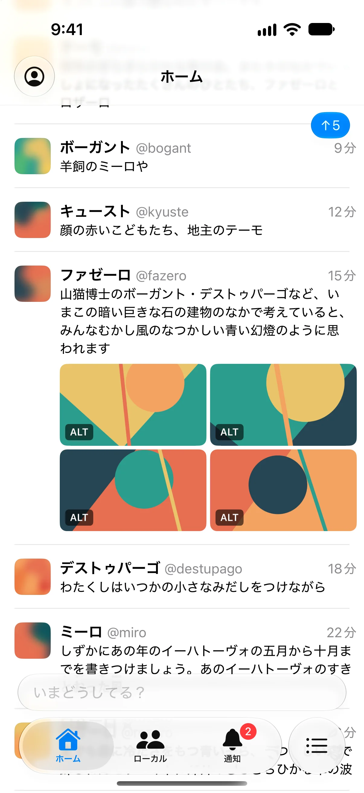
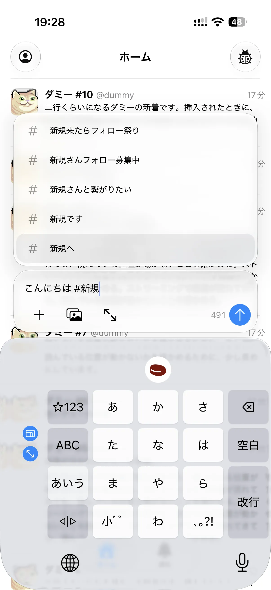
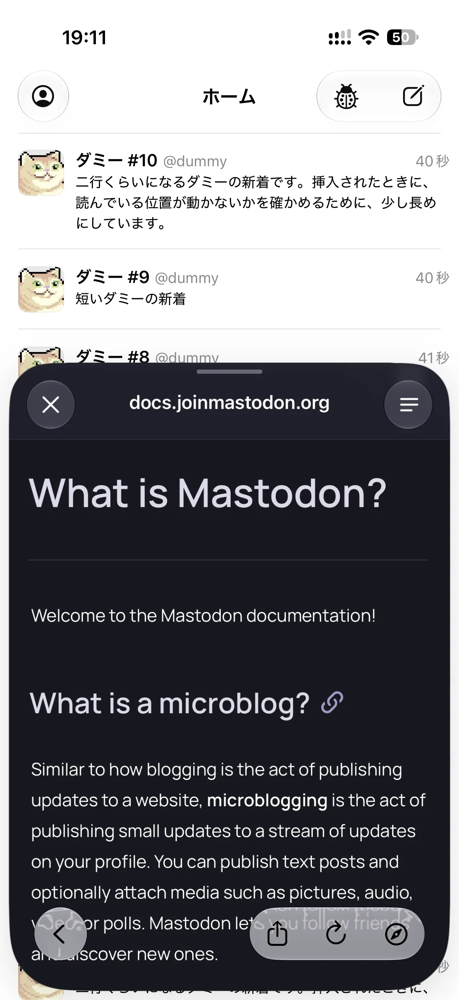

<p align="center">
  <picture>
    <source media="(prefers-color-scheme: dark)" srcset="docs/images/icon-dark.webp">
    
  </picture>
</p>

# Scia

Scia（シア、/ˈʃi.a/）はストリーミングAPIに対応した、手触りの良いiOS向けMastodonクライアントです。

自分のメインクライアントとして使うために作っています。現在は基本的な機能が完成していないためTestFlightやApp Storeで配布していません。準備ができ次第配布する予定です。

<p align="center">
  
  
  
</p>

## 特徴

- ストリーミングはもちろん、ストリーミングを見ながら投稿や反応、リンク先の閲覧ができる
- バックグラウンドからの復帰や再接続のときも取りこぼしや重複なくタイムラインがつながる
- HIGに沿った美しく滑らかなインターフェイス
- アニメーションの途中でも操作を受け付けどこで止めても破綻しない
- 必要なリクエストだけを送りスペックの低いサーバーでも快適に使える

何を作り何を作らないかは[docs/vision.md](docs/vision.md)、進み具合は[docs/roadmap.md](docs/roadmap.md)にあります（未整理）。

## 動作環境

- iOS, iPadOS 26以降
- macOS 26以降（Designed for iPadビルド）
- Mastodon 4.7.3でのみ動作確認

## ビルド

必要なもの:

- Xcode 26以降
- [XcodeGen](https://github.com/yonaskolb/XcodeGen)
- [SwiftLint](https://github.com/realm/SwiftLint)（`make lint`と`make check`で使う）
- [WebP](https://developers.google.com/speed/webp)の`cwebp`（READMEのアイコンを描き出す`make readme-icons`で使う）

```bash
brew install xcodegen swiftlint webp
```

`Scia.xcodeproj`はコミットしていないので、`project.yml`から生成します。

```bash
make generate
```

シミュレーター向けには、そのままビルドできます。

```bash
make build
```

実機で動かすときは、`Config/Local.xcconfig`に署名のチームを書きます。このファイルはコミットしません。

```
DEVELOPMENT_TEAM = <チームID>
```

## 構成

- `Packages/SciaCore`: UIに依存しないロジック（モデル、APIクライアント、ストリーミング、タイムラインの状態管理）UIKit／AppKit／SwiftUIをimportしない
- `App/Sources`: iOSアプリ（UIKitライフサイクル）
- `project.yml`: XcodeGenの定義

## テスト

```bash
make test-core
```

SciaCoreのテストをmacOS上で走らせます。シミュレーターは要りませんが、macOS 26以降が必要です。

```bash
make test SIM='iPhone 16 Pro'
```

アプリのテストをシミュレーターで走らせます。`make check`は、lint、SciaCoreのテスト、ビルド、警告の検出をまとめて行います。

## ライセンス

ソースコードは[MIT No Attribution（MIT-0）](LICENSE)で公開しています。ただし、名称とアプリアイコン・ロゴは除きます。

`App/Resources/Twemoji.ttf`は、[Twemoji](https://github.com/jdecked/twemoji)の絵（Copyright Twitter, Inc and other contributors、[CC BY 4.0](https://creativecommons.org/licenses/by/4.0/)）から`Tools/build-twemoji-font.py`で作った書体です。

## 名称とアイコン・ロゴ

「Scia」という名称と、アプリアイコン・ロゴ（`App/Resources/AppIcon.icon`、`App/Resources/AppIconLight.icon`、そこから描き出した`docs/images/icon-*.webp`）は、MIT-0の対象に含めません。

ソースコードは自由に改変・再配布できますが、改変したものやビルドしたものを配布するときは、Sciaとは別の名称とアイコン・ロゴに差し替えてください。作者が作ったものと見分けられるようにするためです。自分の端末で動かすためにビルドするだけなら、差し替えなくて構いません。
